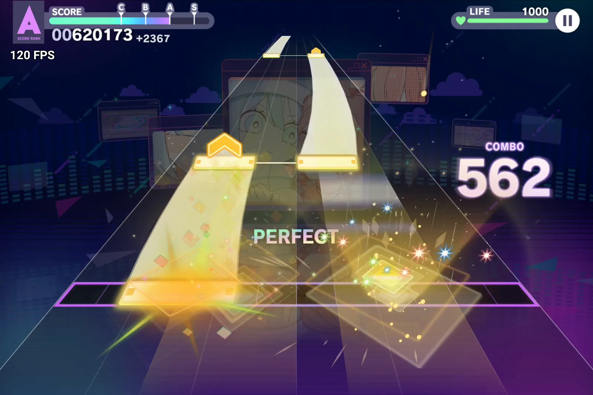
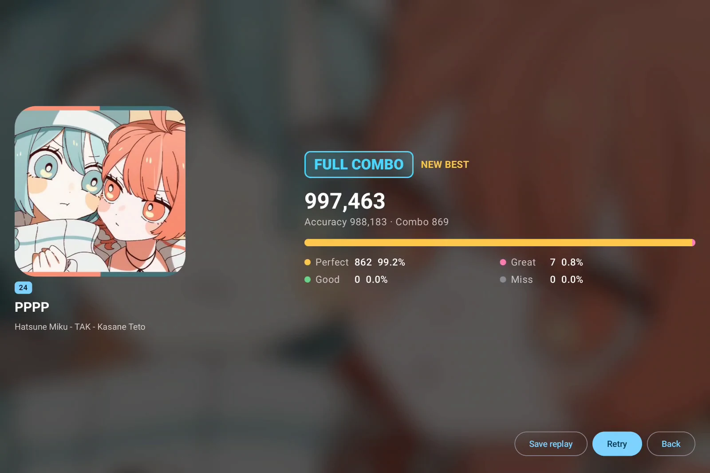
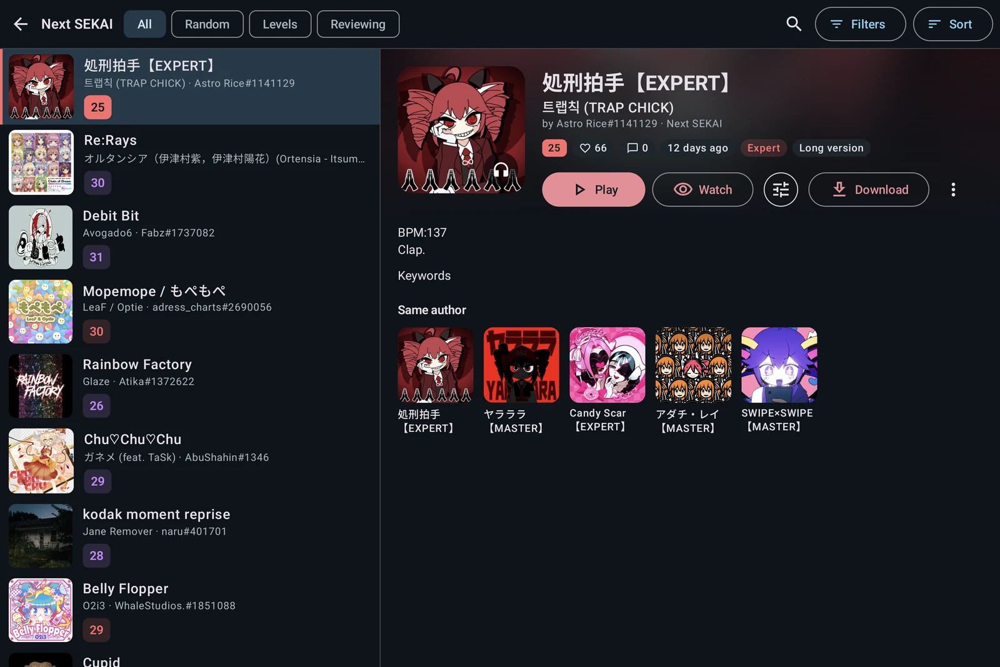
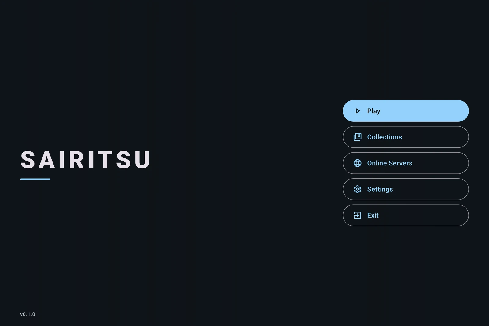
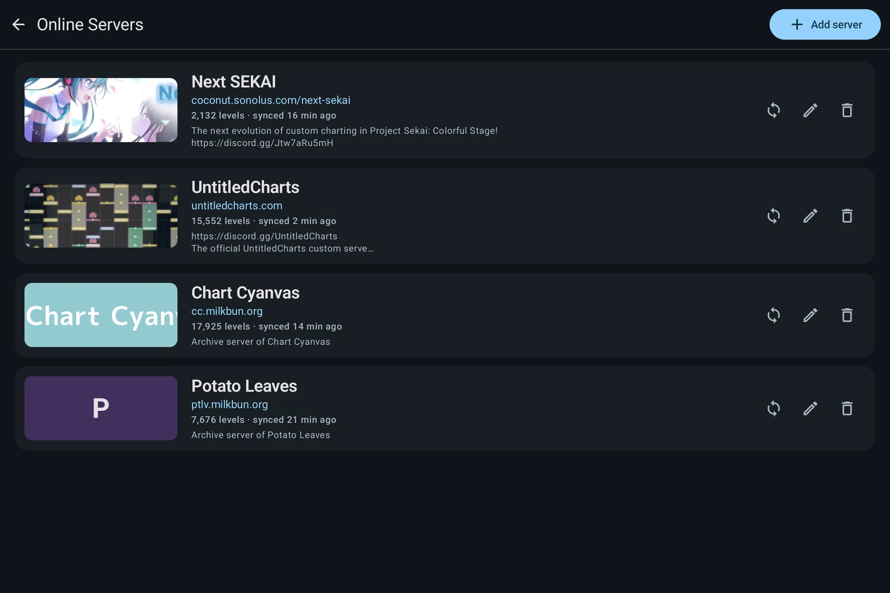
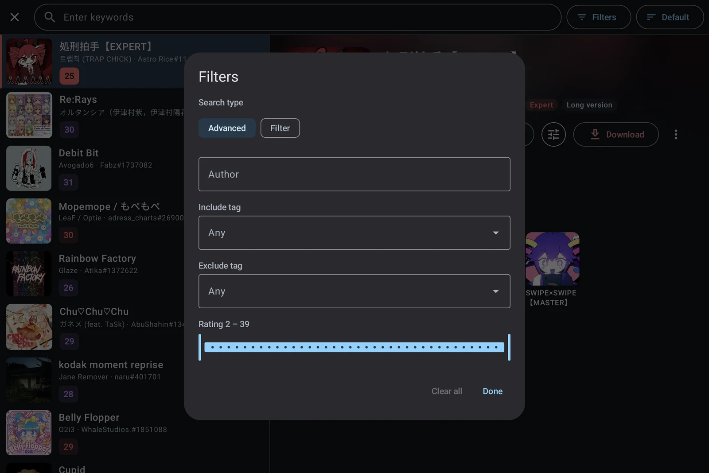
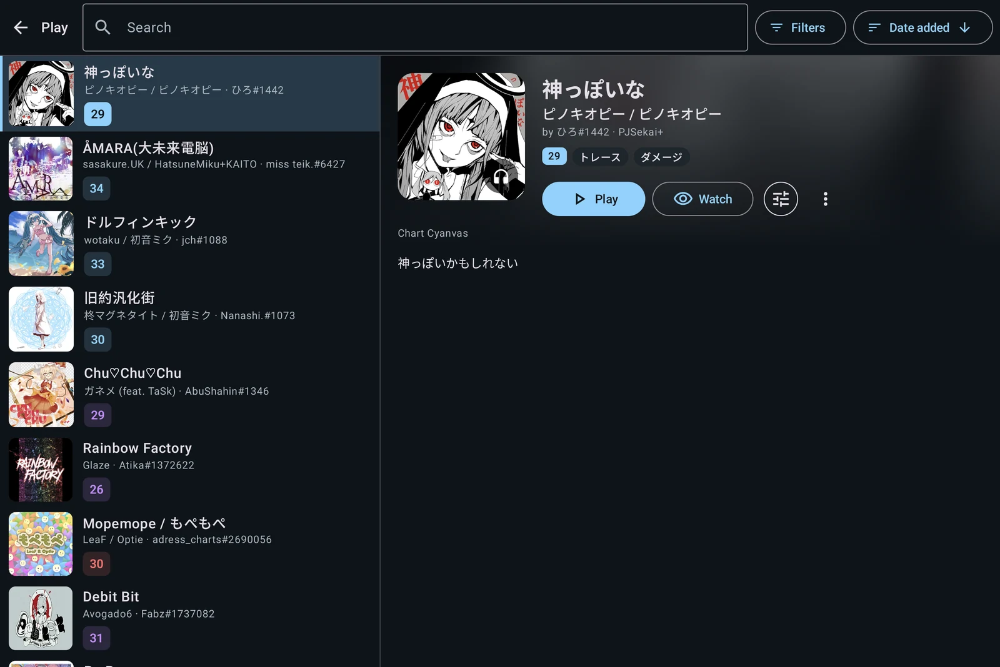
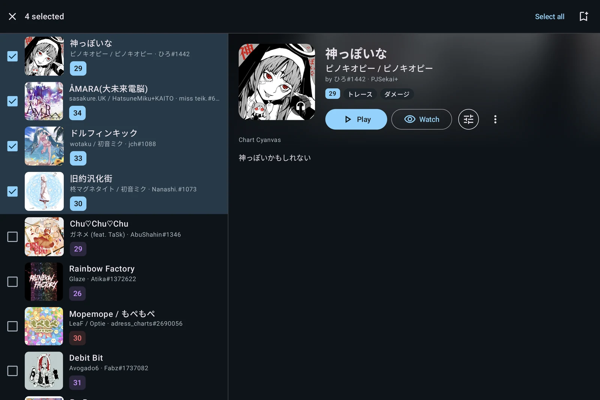
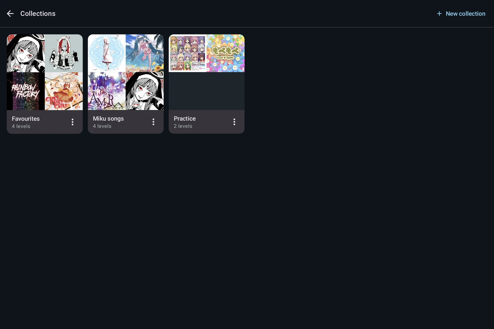

# Sairitsu

Sairitsu is an Android player for community rhythm-game levels. It browses level servers, downloads levels for
offline play, and runs them in a native C++ gameplay runtime, either hands-free (Watch) or played by touch
(Play).

Features:

- Browse and search level servers, with level details, previews and server-provided sections.
- An offline library of downloaded levels, with collections.
- Watch mode with seeking and looping, and Play mode with pause, retry, results, run history and saved replays.
- A deterministic runtime: the same level and inputs give the same frames, on the PC and on the device.

Sairitsu ships with no server configured: it only talks to servers you add yourself.

## Download

Get the APK from the [Releases](../../releases) page. It needs Android 8.0 or newer, on an arm64 device (or an
x86_64 emulator).

## Screenshots



| | |
| --- | --- |
|  |  |
| The result screen: score, accuracy and judgment breakdown | Browse a server: level list and details side by side |
|  |  |
| Main menu | Your servers, with level counts and sync status |
|  |  |
| Server-provided search filters | Downloaded levels, ready to play offline |
|  |  |
| Select levels to add them to a collection | Collections of downloaded levels |

Level artwork shown belongs to the respective song and chart creators.

## Repository layout

| Path | What |
| --- | --- |
| `app/` | The Android app (Kotlin, Jetpack Compose). Package `my.fumui.sairitsu`. |
| `runtime/` | The native gameplay runtime (C++20): engine VM, audio, rendering, Watch and Play sessions. |
| `runtime/tools/srun/` | Headless Watch and Play drivers, a frame dump format and sha256, used by the tests. |
| `runtime/tests/` | The C++ test suite (`sr_tests`, doctest) and its fixtures. |
| `runtime/third_party/` | Vendored libraries; see [THIRD_PARTY_NOTICES.md](THIRD_PARTY_NOTICES.md). |
| `tools/` | Python tooling (`sairitsu_tools`): code and fixture generators, and a device test runner. |

## Requirements

- JDK 21 (Gradle runs on it; the app targets Java 17 bytecode)
- Android SDK with platform 36, NDK `28.2.13676358` and CMake `3.22.1` (Android Studio installs these)
- For the host C++ tests: CMake 3.22+, Ninja and LLVM/clang
- For the tools: Python 3.12+

The CMake presets in `runtime/CMakePresets.json` assume the default Windows locations
(`C:/Program Files/LLVM/bin` and `%LOCALAPPDATA%/Android/Sdk`). Edit them, or add a `CMakeUserPresets.json`,
if yours differ.

## Build the app

```sh
./gradlew assembleDebug          # app/build/outputs/apk/debug/app-debug.apk
./gradlew testDebugUnitTest      # Kotlin unit tests
```

Gradle builds the native runtime (`libsairitsu_runtime.so`) for `arm64-v8a` and `x86_64` through
`runtime/CMakeLists.txt`.

### Release builds

`./gradlew assembleRelease` writes `app/build/outputs/apk/release/`. It is signed when a `keystore.properties`
file at the repository root (gitignored) names the keystore:

```properties
storeFile=/path/to/release.jks
storePassword=...
keyAlias=...
keyPassword=...
```

Without that file the release APK is unsigned. Builds signed with a different key can't update an installed
release; uninstall it first.

## Runtime tests on the PC

From `runtime/`:

```sh
cmake --preset host
cmake --build --preset host
ctest --preset host
```

On Linux, or anywhere with Docker, use the `linux` preset inside the image CI uses (`runtime/Dockerfile`,
Ubuntu 24.04 with clang 20):

```sh
docker build -t sairitsu-ci .
docker run --rm -v "$PWD":/src -w /src sairitsu-ci \
  sh -c 'cmake --preset linux && cmake --build --preset linux && ctest --preset linux'
```

`ctest` runs `sr_tests` and `no_platform_libm`, which checks that no float math links against the platform
libm. Keeping host and device results bit-identical depends on that.

Every test runs on the fixtures in `runtime/tests/fixtures`: small engines built with sonolus.py
(`fixtures/engines`), golden vectors, audio clips and a replay. Nothing is downloaded.

## Tools

Set up once, from `tools/`:

```sh
python -m venv .venv && .venv/Scripts/pip install -e .      # .venv/bin/pip on Linux and macOS
```

Then `.venv/Scripts/python -m sairitsu_tools <command>`:

| Command | What |
| --- | --- |
| `gen-blocks --wiki <dir>` | Regenerate `runtime/src/vm/blocks_{watch,play}.inc` from sonolus.py and the engine-spec wiki's block pages (saved as text in `<dir>`). |
| `golden` | Regenerate the golden vectors in `runtime/tests/fixtures/golden` (sonolus.py interpreter results). |
| `build-engines` | Rebuild the mini test engines in `runtime/tests/fixtures/engines`. |
| `device-tests` | Build `sr_tests` for arm64, push it with its fixtures to an adb device and run it there. |

Run the tools' own tests with `.venv/Scripts/python -m pytest` from `tools/`. `device-tests` uses the
adb serial from `--serial`, `$ANDROID_SERIAL` or `tools/device.local.toml` (`serial = "..."`, gitignored).

## Debug builds

Debug builds add an exported activity alias for scripted runs from a PC:

```sh
adb shell am start -n my.fumui.sairitsu/.gameplay.DebugGameplayEntry \
    --es server <server URL> --es level <level name> --es mode watch
```

Debug builds also log one `sairitsu_judge` logcat line per counted judgment in Play.

## License

[MIT](LICENSE). The vendored libraries keep their own licences; see [THIRD_PARTY_NOTICES.md](THIRD_PARTY_NOTICES.md).
